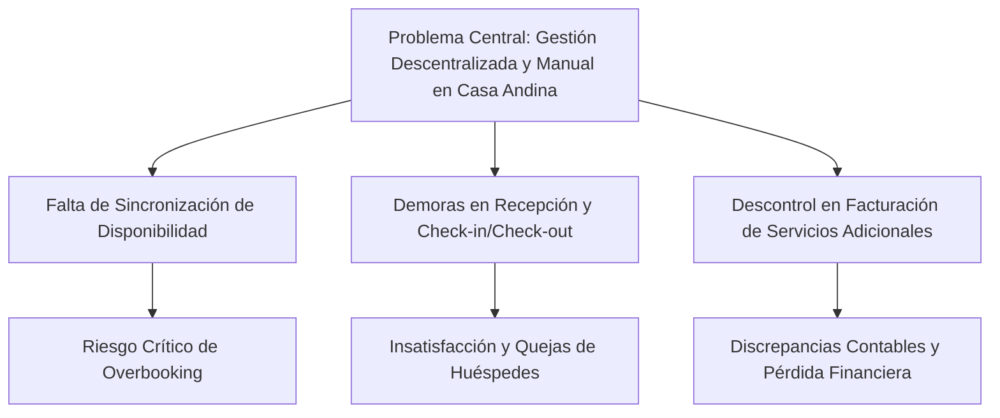
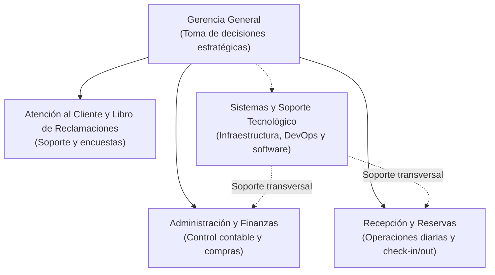
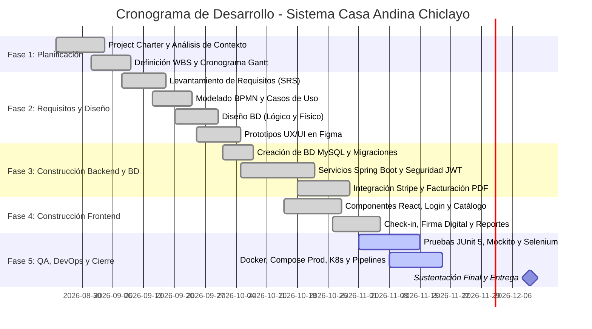
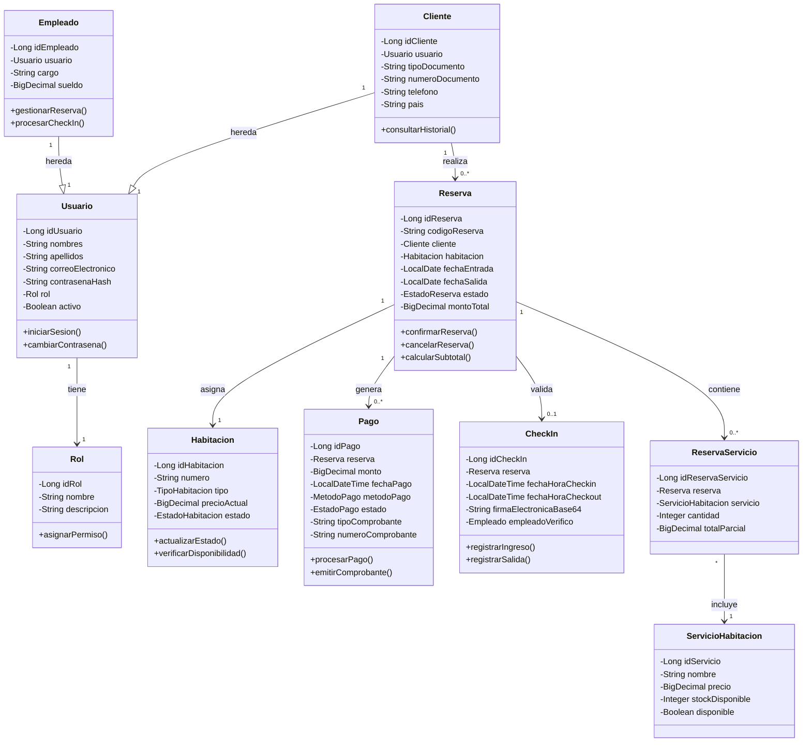
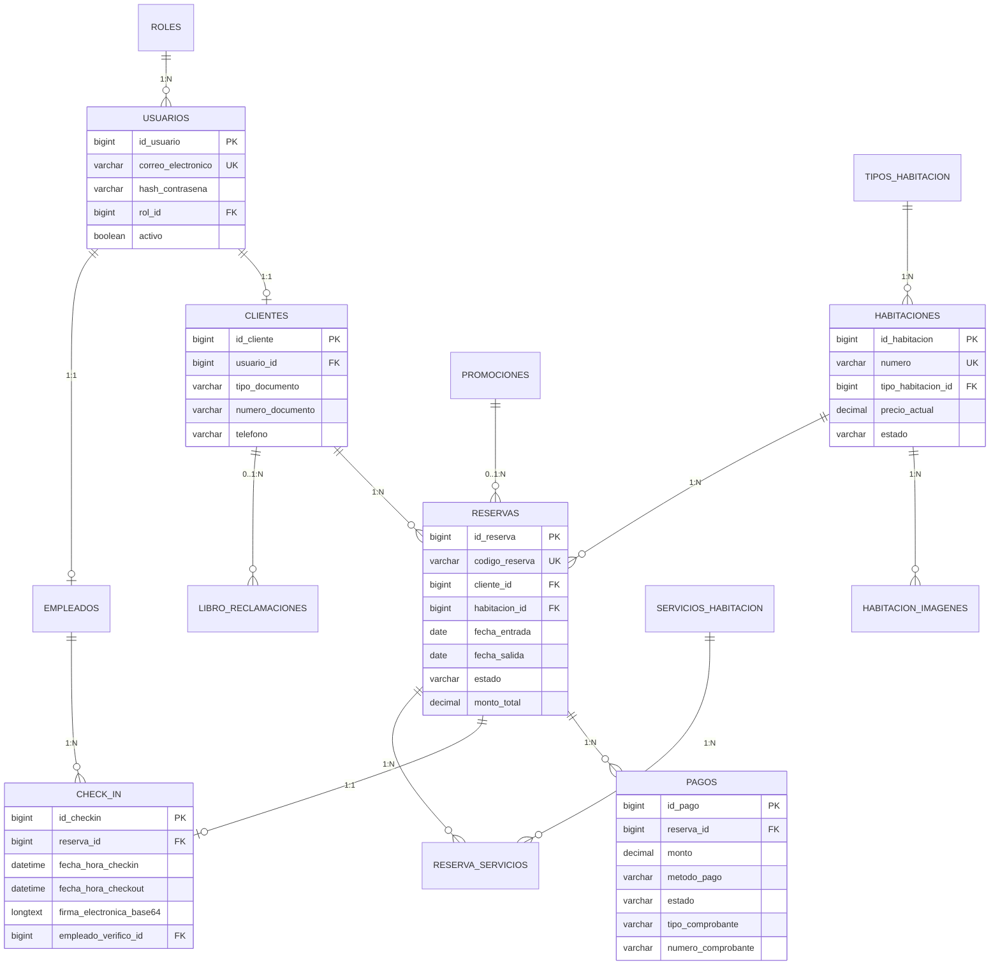
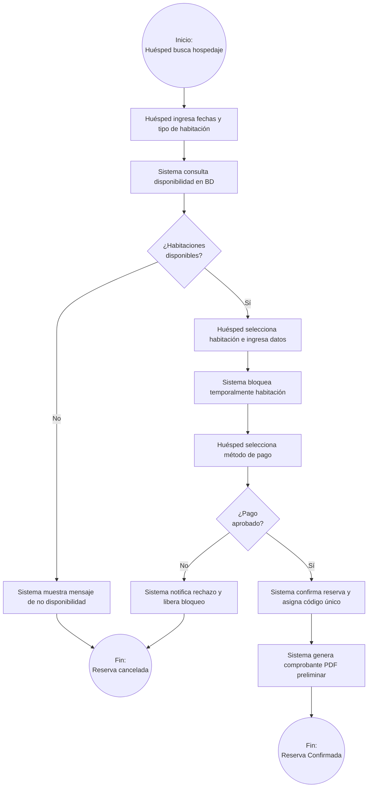
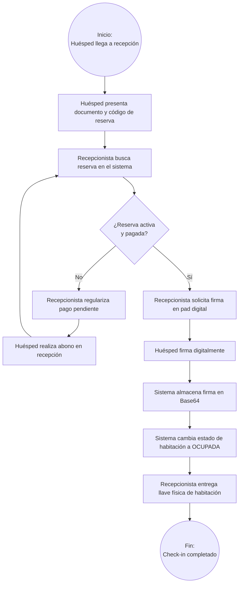
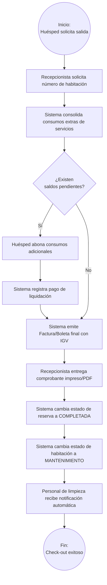

# INFORME DE AVANCE DE PROYECTO FINAL 3 (APF3)

**UNIVERSIDAD TECNOLÓGICA DEL PERÚ (UTP)**  
**Facultad de Ingeniería de Sistemas e Informática**  
**Curso:** Herramientas de Desarrollo (Sección 26333)  
**Semana:** 15 – Avance de Proyecto Final 3  
**Ciclo Académico:** 2026 - II  
**Sede:** Chiclayo – Perú  

---

### **TÍTULO DEL PROYECTO:**
## **Implementación de un Sistema Web Integral para la Gestión de Reservas, Recepción y Control Operativo del Hotel Casa Andina – Sede Chiclayo**

---

### **INTEGRANTES:**
- **Salas Bances, Ángel Eduardo** – Código: `U24265115`
- **Niño Falla, Luis Gianfranco** – Código: `U22219618`

### **DOCENTE:**
- **Fernández Guerrero, Anaximandro**

---

## ÍNDICE GENERAL

1. [Resumen Ejecutivo](#1-resumen-ejecutivo)
2. [Introducción y Objetivos](#2-introducción-y-objetivos)
   - 2.1. Objetivo General
   - 2.2. Objetivos Específicos
3. [Capítulo I: Análisis del Contexto Organizacional](#capítulo-i-análisis-del-contexto-organizacional)
   - 3.1. Contexto de la Empresa
   - 3.2. Definición del Problema
   - 3.3. Impacto en los Procesos del Negocio
   - 3.4. Estructura Organizacional y Organigrama Funcional
   - 3.5. Filosofía Organizacional: Misión, Visión y Valores
   - 3.6. Análisis del Entorno Competitivo
   - 3.7. Estrategias y Planes de Mejora Digital
   - 3.8. Análisis FODA Estratégico
   - 3.9. Modelo de Negocio: Lean Canvas
4. [Capítulo II: Planteamiento y Evaluación de Alternativas de Solución](#capítulo-ii-planteamiento-y-evaluación-de-alternativas-de-solución)
   - 4.1. Descripción de las Tres Alternativas Tecnológicas
   - 4.2. Especificación de Pantallas y Funcionalidades por Alternativa (≥ 5 pantallas c/u)
   - 4.3. Matriz Comparativa Multicriterio
   - 4.4. Justificación de la Alternativa Seleccionada
   - 4.5. Referencia a Prototipos Wireframe / Mockup (Figma)
5. [Capítulo III: Planificación y Herramientas de Gestión del Proyecto](#capítulo-iii-planificación-y-herramientas-de-gestión-del-proyecto)
   - 5.1. Project Charter Básico Formal
   - 5.2. Estructura de Desglose del Trabajo (WBS / EDT)
   - 5.3. Diagrama de Gantt y Cronograma Temporal
   - 5.4. Diagrama UML de Clases del Sistema
   - 5.5. Diagrama Entidad-Relación (Modelo Físico y Relacional)
6. [Capítulo IV: Análisis de la Solución (Estándar SRS / IEEE 830)](#capítulo-iv-análisis-de-la-solución-estándar-srs--ieee-830)
   - 6.1. Requerimientos Funcionales (RF-01 a RF-20)
   - 6.2. Requerimientos No Funcionales (RNF-01 a RNF-12)
   - 6.3. Restricciones Técnicas y Reglas de Negocio (RN-01 a RN-10)
   - 6.4. Casos de Uso Principales y Matriz de Trazabilidad
   - 6.5. Criterios de Aceptación del Software
   - 6.6. Modelado de Procesos de Negocio con Notación BPM / BPMN 2.0
7. [Capítulo V: Diseño de la Solución (Datos y UX/UI)](#capítulo-v-diseño-de-la-solución-datos-y-uxui)
   - 7.1. Diseño Lógico y Físico de Base de Datos
   - 7.2. Principios UX y Guía de Estilos UI
8. [Capítulo VI: Gestión de Configuración y Control de Versiones (Git Flow)](#capítulo-vi-gestión-de-configuración-y-control-de-versiones-git-flow)
9. [Capítulo VII: Herramientas de Colaboración y Gestión de Proyectos](#capítulo-vii-herramientas-de-colaboración-y-gestión-de-proyectos)
10. [Capítulo VIII: Temas de Unidad 3 – Plataformas en la Nube, Contenedores y Despliegue](#capítulo-viii-temas-de-unidad-3--plataformas-en-la-nube-contenedores-y-despliegue)
    - 10.1. Arquitectura y Plataformas en la Nube
    - 10.2. Contenedores con Docker: Dockerfiles Multi-stage
    - 10.3. Despliegue Orquestado con Docker Compose (Desarrollo y Producción con Caddy TLS)
    - 10.4. Despliegue y Orquestación con Kubernetes (K8s)
11. [Capítulo IX: Herramientas de Verificación y Pruebas de Software](#capítulo-ix-herramientas-de-verificación-y-pruebas-de-software)
    - 11.1. Pruebas Unitarias con JUnit 5 y Mocks con Mockito
    - 11.2. Pruebas de Aislamiento de Seguridad y Control de Acceso
    - 11.3. Pruebas de Integración E2E en Navegador con Selenium WebDriver
12. [Capítulo X: Herramientas de Integración Continua (CI/CD) y DevOps](#capítulo-x-herramientas-de-integración-continua-cicd-y-devops)
    - 12.1. Techsoft: Integración Git + Jenkins + Docker
    - 12.2. Pipelines de Integración en GitHub Actions, GitLab CI y Azure Pipelines
13. [Capítulo XI: Sistemas de Seguimiento de Incidentes y Gestión de Servicios (ITSM)](#capítulo-xi-sistemas-de-seguimiento-de-incidentes-y-gestión-de-servicios-itsm)
    - 13.1. Jira Software (Atlassian)
    - 13.2. InvGate Service Desk
    - 13.3. Freshservice
    - 13.4. ComplianceQuest
    - 13.5. Cuadro Comparativo y Selección Justificada
14. [Capítulo XII: Documentación Técnica de Implementación](#capítulo-xii-documentación-técnica-de-implementación)
15. [Conclusiones y Recomendaciones](#conclusiones-y-recomendaciones)
16. [Referencias Bibliográficas (APA 7ma Edición / IEEE)](#referencias-bibliográficas-apa-7ma-edición--ieee)

---

## 1. RESUMEN EJECUTIVO

El presente informe constituye el **Avance de Proyecto Final 3 (Semana 15)** de la asignatura *Herramientas de Desarrollo*. Tiene como propósito documentar la planificación, modelado, arquitectura, verificación y despliegue del sistema de software desarrollado para la empresa hotelera **Casa Andina – Sede Chiclayo**. 

La problemática central de la empresa radicaba en la fragmentación de la información de reservas, descontrol en el inventario de habitaciones en tiempo real, demoras en el check-in/check-out y la ausencia de integración con pasarelas de pago y facturación electrónica formal, lo que generaba duplicidad de reservas (overbooking) y pérdida de ingresos potenciales.

Para dar solución integral a esta situación, se diseñó e implementó un aplicativo web corporativo de alta escalabilidad compuesto por una arquitectura desacoplada:
- **Backend:** Desarrollado al 100% en **Java 25** con el framework **Spring Boot 3.5.16**, Spring Security con autenticación stateless mediante **JWT**, persistencia relacional con **Spring Data JPA / Hibernate**, integración de pagos con **Stripe API**, exportación documental con **iText7** (PDF) y **Apache POI** (Excel), y base de datos relacional **MySQL 8.4**.
- **Frontend:** Single Page Application (SPA) desarrollada en **React 18** con **Vite 5**, arquitectura modular por componentes, enrutamiento con React Router DOM v6 y diseño responsivo con soporte de modo oscuro (*dark theme*).
- **DevOps y Nube:** Contenedorización mediante **Docker** multi-stage, orquestación en **Docker Compose** y manifiestos de **Kubernetes (K8s)**, proxy inverso seguro con **Caddy** (HTTPS automático con TLS), pipelines de Integración Continua (CI/CD) multiplataforma (**GitHub Actions, GitLab CI, Azure Pipelines, Jenkins**) y pruebas automatizadas piramidales con **JUnit 5, Mockito y Selenium WebDriver**.

El proyecto cumple estrictamente con el estándar **IEEE 830 (SRS)**, modelado de procesos en **BPMN 2.0**, buenas prácticas de ingeniería de software y la rúbrica de evaluación de la Unidad 3.

---

## 2. INTRODUCCIÓN Y OBJETIVOS

En la industria hotelera moderna, la competitividad de una cadena de hospedaje depende directamente de la eficiencia operativa en recepción y de la agilidad en los canales digitales de reserva. Casa Andina cuenta con más de tres décadas de liderazgo en el Perú; no obstante, su sede en Chiclayo requería modernizar los procesos manuales y descentralizados que aumentaban los tiempos de atención en mostrador y generaban discrepancias contables.

### 2.1. Objetivo General
Desarrollar y planificar un sistema web integral y automatizado para la gestión de reservas, control de ocupación de habitaciones, registro de huéspedes, pagos electrónicos, facturación detallada y atención al cliente en el Hotel Casa Andina – Chiclayo, garantizando alta disponibilidad, integridad de datos y despliegue continuo mediante contenedores.

### 2.2. Objetivos Específicos
1. **Automatizar el ciclo de vida de las reservas** en tiempo real, evitando el sobrecupo y actualizando los estados de las habitaciones (`DISPONIBLE`, `OCUPADA`, `RESERVADA`, `MANTENIMIENTO`).
2. **Implementar un sistema de autenticación y autorización RBAC (Role-Based Access Control)** con JSON Web Tokens (JWT) para 4 roles bien diferenciados: `ADMIN`, `GERENTE`, `RECEPCIONISTA` y `CLIENTE`.
3. **Integrar una pasarela de pagos digitales y emisión de comprobantes** que admita transacciones con tarjeta vía Stripe, billeteras digitales (Yape/Plin en modo demostrativo) y cálculo automático del IGV (18%) con descarga de boletas y facturas en formato PDF formal.
4. **Modelar los procesos del negocio mediante notación BPMN 2.0**, optimizando los flujos de Reserva, Check-in presencial/digital y Check-out con cargos por consumos y servicios de habitación.
5. **Configurar el ciclo de vida DevOps completo**: pruebas unitarias (`JUnit 5 + Mockito`), pruebas E2E en navegador (`Selenium Chrome Headless`), pipelines de CI/CD (`GitHub Actions, GitLab, Jenkins, Azure`) y empaquetado reproducible en contenedores `Docker` y clúster `Kubernetes`.

---

## CAPÍTULO I: ANÁLISIS DEL CONTEXTO ORGANIZACIONAL

### 3.1. Contexto de la Empresa
**Casa Andina Hoteles** es la cadena hotelera peruana más representativa del país. En la sede de Chiclayo (Lambayeque), el hotel atiende tanto a turistas nacionales y extranjeros como a viajeros corporativos y de negocios. El dinamismo comercial de la región exige una respuesta inmediata a las consultas de disponibilidad y una gestión transparente de tarifas, servicios y comprobantes de pago.

### 3.2. Definición del Problema
En el diagnóstico situacional inicial se detectaron las siguientes problemáticas críticas:
- **Gestión fragmentada y manual:** Uso excesivo de hojas de cálculo (Excel) y libretas de recepción para asentar reservas telefónicas y presenciales.
- **Descoordinación en tiempo real:** Retrasos entre la salida de un huésped y la notificación al personal de limpieza, provocando que habitaciones listas figuren como ocupadas o viceversa.
- **Riesgo de Overbooking:** Al no existir un inventario centralizado sincronizado, se producían solapamientos de reservas en fechas de alta demanda (feriados, eventos comerciales).
- **Procesamiento lento de pagos y facturación:** Dificultad para consolidar los consumos extras (frigobar, lavandería, room service) con el costo base del hospedaje al momento del check-out.



### 3.3. Impacto en los Procesos del Negocio
- **Proceso de Reserva:** Pérdida de hasta un 25% de conversiones directas por falta de un canal web interactivo 24/7.
- **Proceso de Recepción:** Tiempos de espera de más de 12 minutos por huésped para completar el registro de entrada.
- **Proceso Administrativo:** Demora de varios días para que la Gerencia obtenga reportes consolidados de ocupación e ingresos mensuales.

### 3.4. Estructura Organizacional y Organigrama Funcional



- **Gerencia General:** Requiere dashboards con métricas clave (KPIs) de ingresos diarios, ocupación porcentual y tipos de habitación más demandados.
- **Administración:** Supervisa la recaudación, valida compras de insumos, auditoría de pagos y descarga reportes en Excel/CSV.
- **Recepción y Reservas:** Gestiona la asignación física de llaves/habitaciones, verifica documentos de identidad (DNI/Pasaporte), ejecuta el check-in con firma digital y el check-out.
- **Atención al Cliente:** Gestiona el Libro de Reclamaciones digital (según normativa de INDECOPI) y consultas mediante chatbot y WhatsApp.
- **Sistemas y Soporte:** Administra la seguridad perimetral, variables de entorno, base de datos y contenedores en la nube.

### 3.5. Filosofía Organizacional
- **Misión:** Brindar a nuestros huéspedes una experiencia de alojamiento acogedora, confiable y de alta calidad en Chiclayo, respaldada por una plataforma tecnológica eficiente y segura que optimice los procesos de reserva, estancia y facturación.
- **Visión:** Consolidar a Casa Andina Chiclayo como el referente hotelero de la región norte del Perú en excelencia de servicio al cliente y vanguardia digital.
- **Valores:**
  - *Integridad:* Honestidad y total transparencia en tarifas, cargos e impuestos.
  - *Innovación:* Adopción de herramientas tecnológicas modernas (Cloud, Contenedores, CI/CD).
  - *Hospitalidad:* Vocación de servicio orientada al confort del cliente.

### 3.6. Análisis del Entorno Competitivo
El mercado hotelero de Chiclayo cuenta con cadenas nacionales e internacionales, así como alojamientos independientes tipo Airbnb. La ventaja competitiva radica en ofrecer una experiencia de autoservicio digital (reserva, pago con tarjeta o billetera móvil, chatbot informativo instantáneo y confirmación inmediata por correo/PDF).

### 3.7. Estrategias y Planes de Mejora Digital
1. **Plan de Digitalización Integral:** Eliminar en un 100% el soporte en papel para fichas de registro, adoptando firma digital y almacenamiento en BD relacional.
2. **Plan de Omnicanalidad y Autoasistencia:** Integración de chatbot web con respuestas preconfiguradas sobre servicios y redirección directa a WhatsApp corporativo.
3. **Plan de Resiliencia y Seguridad:** Control estricto de accesos vía JWT con expiración automática, contraseñas hasheadas con BCrypt y auditoría de eventos de sistema.

### 3.8. Análisis FODA Estratégico

| Categoría | Factores Internos / Externos |
|---|---|
| **Fortalezas (F)** | • Marca prestigiosa y reconocida a nivel nacional.<br>• Excelente infraestructura y ubicación céntrica en Chiclayo.<br>• Personal de servicio altamente calificado.<br>• Disposición gerencial para adoptar soluciones de software libre y open source. |
| **Oportunidades (O)** | • Crecimiento sostenido del turismo ejecutivo y gastronómico en la región norte.<br>• Creciente preferencia de los usuarios por reservas web directas sin intermediarios.<br>• Reducción de costos de infraestructura mediante contenedores Docker y CI/CD automatizado. |
| **Debilidades (D)** | • Dependencia previa de registros manuales y hojas Excel desconectadas.<br>• Falta previa de una pasarela de pago en línea en la sede local.<br>• Curva de aprendizaje inicial del personal operativo ante sistemas modernos. |
| **Amenazas (A)** | • Alta competencia de plataformas agregadoras (Booking, Expedia) con altas comisiones.<br>• Posibles cortes de suministro eléctrico o conectividad en la zona.<br>• Riesgos de ciberataques e intentos de fraude con tarjetas de crédito. |

---

### 3.9. Modelo de Negocio: Lean Canvas (Casa Andina Chiclayo)

```mermaid
flowchart TD
    subgraph LEAN_CANVAS["LEAN CANVAS - SISTEMA DE RESERVAS CASA ANDINA CHICLAYO"]
        direction TB
        c1["1. PROBLEMA<br>• Registro manual fragmentado<br>• Falta de disponibilidad en vivo<br>• Overbooking y filas en check-in<br>• Facturación desconectada"]
        c2["2. SEGMENTO DE CLIENTES<br>• Turistas y viajeros de negocios<br>• Familias y parejas<br>• Usuarios internos: Recepcionistas, Administradores, Gerencia"]
        c3["3. PROPUESTA DE VALOR<br>• Experiencia ágil de reserva 24/7<br>• Check-in digital con firma<br>• Transparencia con cálculo IGV<br>• Gestión operativa en un solo clic"]
        c4["4. SOLUCIÓN<br>• Plataforma web responsiva<br>• Pasarela Stripe y Yape/Plin<br>• Generador de boleta/factura PDF<br>• Chatbot y soporte WhatsApp"]
        c5["5. CANALES<br>• Portal Web institucional<br>• Chatbot interactivo<br>• Notificaciones por correo<br>• Enlace directo a WhatsApp"]
        c6["6. FLUJO DE INGRESOS<br>• Cobro por noches de alojamiento<br>• Venta de servicios extra (room service, lavandería)<br>• Paquetes promocionales"]
        c7["7. ESTRUCTURA DE COSTOS<br>• Costo de hosting cloud / VPS<br>• Mantenimiento y soporte DevOps<br>• Comisión de pasarela de pago<br>• Capacitación de personal"]
        c8["8. MÉTRICAS CLAVE<br>• Tasa de conversión de reservas<br>• Tiempo promedio de check-in<br>• Porcentaje de ocupación hotelera<br>• Incidentes/quejas resueltas"]
        c9["9. VENTAJA ESPECIAL<br>• Sistema a medida sin comisiones de terceros<br>• Control total de inventario y datos del cliente<br>• Integración directa con Libro de Reclamaciones oficial"]
    end
```



---

## CAPÍTULO II: PLANTEAMIENTO Y EVALUACIÓN DE ALTERNATIVAS DE SOLUCIÓN

Siguiendo las directrices del curso, se diseñaron y evaluaron **tres alternativas tecnológicas**, cada una con al menos 5 pantallas prototipadas y garantizando al menos un 90% de implementación en el lenguaje tecnológico seleccionado (Java/JavaScript).

### 4.1. Descripción de las Tres Alternativas
1. **Alternativa 1 (Seleccionada): Sistema Web Integral de Reservas y Gestión Hotelera (Full-Stack)**
   - *Arquitectura:* Aplicación web desacoplada. Frontend en React 18 (Vite, TailwindCSS) y Backend en Java 25 (Spring Boot 3.5.16, JPA, Security JWT, MySQL 8.4, Docker).
   - *Enfoque:* Solución 360° que cubre tanto el autoservicio del huésped (catálogo, reservas, pagos, comprobantes, chatbot) como las operaciones internas de la empresa (recepción, check-in con firma, check-out, auditoría, dashboard gerencial, reportes Excel/PDF y gestión de reclamos).
2. **Alternativa 2: Portal Web Exclusivo para Huéspedes (Client-Centric Web App)**
   - *Arquitectura:* Frontend web ligero en React conectado a backend en Node.js/Express y MongoDB.
   - *Enfoque:* Orientado exclusivamente al cliente final para explorar fotos, hacer pagos y ver sus reservas. Deja de lado las funciones operativas de recepción, asignación de llaves físicas, inventario de servicios y reportes de gerencia.
3. **Alternativa 3: Sistema de Gestión Hotelera Administrativo (Backoffice PMS)**
   - *Arquitectura:* Aplicación de escritorio/intranet corporativa en Java Desktop (JavaFX) o web monolítica tradicional en Spring MVC con Thymeleaf y PostgreSQL.
   - *Enfoque:* Centrado exclusivamente en el personal de recepción y administración. Obliga al cliente a llamar por teléfono o apersonarse al hotel para gestionar una reserva.

---

### 4.2. Especificación de Pantallas por Alternativa (≥ 5 Pantallas c/u)

#### Alternativa 1: Sistema Web Integral (7 Pantallas Clave)
1. **Pantalla 1 - Inicio de Sesión y Registro con Roles:** Formulario con validación de credenciales JWT, opción para crear cuenta de cliente o acceder como personal hotelero.
2. **Pantalla 2 - Catálogo y Reserva de Habitaciones (Huésped):** Filtro interactivo por tipo (Simple, Doble, Suite), fechas, precios, galería de imágenes y botón "Reservar Ahora".
3. **Pantalla 3 - Pasarela de Pago y Facturación:** Formulario seguro para tarjeta (Stripe) y billeteras móviles, con selección de comprobante (Boleta o Factura con RUC).
4. **Pantalla 4 - Módulo de Check-in / Check-out (Recepción):** Búsqueda de reserva por código, verificación de documento y lienzo interactivo para captura de firma digital en Base64.
5. **Pantalla 5 - Gestión de Servicios Adicionales:** Catálogo de consumos y servicios a la habitación (desayuno buffet, lavandería, spa) con actualización de saldo en la reserva.
6. **Pantalla 6 - Dashboard Gerencial con Gráficos:** Tarjetas de métricas (KPIs), ocupación actual, ingresos acumulados y gráfico de barras de habitaciones más pedidas.
7. **Pantalla 7 - Libro de Reclamaciones Virtual y Chatbot:** Formulario normativo conforme a INDECOPI con generación de hoja de reclamación y asistente virtual 24/7.

#### Alternativa 2: Portal del Huésped (5 Pantallas)
1. **Pantalla 1 - Landing Page:** Presentación del hotel, banners turísticos y ofertas.
2. **Pantalla 2 - Buscador de Disponibilidad:** Fechas de entrada y salida con selector de huéspedes.
3. **Pantalla 3 - Detalle de Habitación:** Fotografías ampliadas, descripción y amenidades.
4. **Pantalla 4 - Checkout de Pago:** Integración básica con formulario de tarjeta.
5. **Pantalla 5 - Historial de Mis Reservas:** Lista de reservas pasadas y código QR de confirmación.

#### Alternativa 3: Backoffice PMS Administrativo (5 Pantallas)
1. **Pantalla 1 - Login de Empleado:** Acceso por credenciales corporativas internas.
2. **Pantalla 2 - Grid de Ocupación (Rack de Habitaciones):** Matriz visual con código de colores según estado de habitación.
3. **Pantalla 3 - Ficha de Huésped:** Formulario administrativo de datos personales y procedencia.
4. **Pantalla 4 - Registro de Cobros de Caja:** Cuadre de caja diaria e ingresos en efectivo.
5. **Pantalla 5 - Reportes Estadísticos:** Exportación de tablas de ocupación a formatos de oficina.

---

### 4.3. Matriz Comparativa Multicriterio

| Criterio de Evaluación | Ponderación | Alternativa 1 (Integral Web) | Alternativa 2 (Portal Huésped) | Alternativa 3 (PMS Backoffice) |
|---|:---:|:---:|:---:|:---:|
| **Cobertura Funcional del Negocio** | 25% | **5 / 5** (Total) | 2.5 / 5 (Solo cliente) | 3.0 / 5 (Solo interno) |
| **Experiencia de Usuario (UX/UI)** | 20% | **4.8 / 5** (Moderna SPA) | 4.5 / 5 (Buena para cliente) | 2.5 / 5 (Compleja/Árida) |
| **Seguridad y Control de Acceso (RBAC)** | 15% | **5 / 5** (JWT + 4 Roles) | 3.0 / 5 (Autenticación básica) | 4.0 / 5 (Roles de escritorio) |
| **Escalabilidad y Despliegue Cloud** | 15% | **5 / 5** (Docker + K8s) | 4.0 / 5 (PaaS simple) | 2.0 / 5 (Monolito local) |
| **Integración con Pagos y Facturación** | 15% | **5 / 5** (Stripe + PDF IGV) | 3.5 / 5 (Solo pago digital) | 3.0 / 5 (Solo caja física) |
| **Costo y Facilidad de Mantenimiento** | 10% | **4.5 / 5** (Open Source) | 4.0 / 5 (Bajo costo inicial) | 2.5 / 5 (Alto costo mant.) |
| **PUNTAJE PONDERADO TOTAL** | **100%** | **4.88 / 5.0** 🏆 | **3.45 / 5.0** | **2.85 / 5.0** |

### 4.4. Justificación de la Alternativa Seleccionada
Se seleccionó de forma unánime la **Alternativa 1**. Es la única propuesta que resuelve de raíz el problema central identificado en Casa Andina Chiclayo: unifica en una sola base de datos y plataforma tanto a los huéspedes que reservan desde cualquier dispositivo como al personal del hotel que opera el check-in, la facturación y la gerencia estratégica.

### 4.5. Referencia a Prototipos en Figma
Los wireframes y mockups interactivos de alta fidelidad se encuentran documentados y accesibles en los siguientes enlaces públicos de Figma:
- Prototipo Sistema Integral y Diseño General: [Figma Mini-Design System](https://www.figma.com/design/9P7GFCjKn3NX1SoWWoOrgT/Mini-Design-System--Community-)
- Mockup Alternativa 2: [Figma Guest Experience](https://www.figma.com/design/58T4jNrQ8ygUfcZev4b8Sz/Sin-t%C3%ADtulo)
- Mockup Componentes y Seguridad: [Figma Security & Tasks](https://www.figma.com/design/u8T3sCYFrU9oEEjX9MOXss/Task---Design-File-for-Change-Password-Functionality--Community-)

---

## CAPÍTULO III: PLANIFICACIÓN Y HERRAMIENTAS DE GESTIÓN DEL PROYECTO

### 5.1. Project Charter Básico Formal

| Campo | Detalle Informativo |
|---|---|
| **Nombre del Proyecto** | CASA ANDINA – SISTEMA INTEGRAL DE GESTIÓN DE RESERVAS HOTELERAS |
| **Jefe de Proyecto** | Luis Gianfranco Niño Falla (`U22219618`) |
| **Líder de Desarrollo y BD** | Salas Bances, Ángel Eduardo (`U24265115`) |
| **Patrocinador / Cliente** | Hotel Casa Andina – Sede Chiclayo (Gerencia Juan Stoesse) |
| **Supervisor Académico** | Mg. Anaximandro Fernández Guerrero |
| **Fecha de Inicio / Fin** | 24 de Agosto de 2026 – 10 de Diciembre de 2026 (16 Semanas) |
| **Justificación del Proyecto** | Eliminar el registro manual de reservas, mitigar el 100% del riesgo de overbooking, agilizar el check-in a menos de 3 minutos y formalizar la facturación electrónica con cálculo de IGV. |
| **Alcance Comprometido** | Módulos de autenticación JWT, catálogo de habitaciones, motor de reservas, check-in con firma táctil, pasarela de pago Stripe + Yape/Plin, facturación PDF, reportería Excel/CSV, chatbot y panel administrativo. |
| **Entregables Principales** | Código fuente backend (JAR Spring Boot), frontend (build React/Vite), scripts SQL de BD, Dockerfiles, docker-compose, manifiestos K8s, informes APA e IEEE, manual de usuario. |
| **Presupuesto Total Estimado** | **S/ 5,150.00** (Desarrollo: S/ 2,000; Soporte: S/ 2,000; Infraestructura Cloud: S/ 500; Mantenimiento: S/ 500; Capacitación: S/ 150). |

---

### 5.2. Estructura de Desglose del Trabajo (WBS / EDT)

```mermaid
graph TD
    WBS["1.0 Sistema Web Hotel Casa Andina"]
    
    F1["1.1 Gestión y Planificación"]
    F2["1.2 Análisis y Requisitos (SRS)"]
    F3["1.3 Diseño Arquitectónico y BD"]
    F4["1.4 Construcción y Desarrollo"]
    F5["1.5 Pruebas, DevOps y Despliegue"]

    WBS --> F1
    WBS --> F2
    WBS --> F3
    WBS --> F4
    WBS --> F5

    F1 --> F11["1.1.1 Project Charter y Costos"]
    F1 --> F12["1.1.2 Tablero Jira y Sprints"]
    F1 --> F13["1.1.3 Diagrama de Gantt"]

    F2 --> F21["1.2.1 Especificación IEEE 830 (RF / RNF)"]
    F2 --> F22["1.2.2 Reglas de Negocio"]
    F2 --> F23["1.2.3 Modelado BPMN de Procesos"]

    F3 --> F31["1.3.1 Diagrama de Clases UML"]
    F3 --> F32["1.3.2 Diagrama Entidad-Relación"]
    F3 --> F33["1.3.3 Prototipado UX/UI en Figma"]

    F4 --> F41["1.4.1 Backend Spring Boot 3.5 & Seguridad JWT"]
    F4 --> F42["1.4.2 Frontend SPA en React 18"]
    F4 --> F43["1.4.3 Facturación PDF (iText7) y Reportes Excel"]
    F4 --> F44["1.4.4 Pasarela de Pagos Stripe"]

    F5 --> F51["1.5.1 Pruebas Unitarias JUnit 5 + Mockito"]
    F5 --> F52["1.5.2 Pruebas E2E Selenium WebDriver"]
    F5 --> F53["1.5.3 Contenedorización Docker y K8s"]
    F5 --> F54["1.5.4 Pipelines CI/CD (GitHub, GitLab, Jenkins)"]
```



---

### 5.3. Diagrama de Gantt y Planificación Temporal



---

### 5.4. Diagrama UML de Clases del Sistema

El modelado orientado a objetos se sustenta directamente en las entidades JPA construidas en el paquete `com.reservashoteleras.entity`:



---

### 5.5. Diagrama Entidad-Relación (Modelo Relacional Físico)

A continuación se representa el modelo de datos correspondiente a las 17 tablas físicas implementadas en MySQL 8.4:



---

## CAPÍTULO IV: ANÁLISIS DE LA SOLUCIÓN (ESTÁNDAR SRS / IEEE 830)

### 6.1. Requerimientos Funcionales (RF)

| Código | Nombre del Requerimiento | Descripción Detallada | Prioridad |
|:---:|---|---|:---:|
| **RF-01** | Autenticación JWT | Permitir a los usuarios iniciar sesión mediante correo y contraseña, recibiendo un token Bearer firmado digitalmente. | Alta |
| **RF-02** | Control de Acceso por Roles (RBAC) | Restringir el acceso a rutas del frontend y endpoints de API según los roles: `ADMIN`, `GERENTE`, `RECEPCIONISTA` y `CLIENTE`. | Alta |
| **RF-03** | Catálogo de Habitaciones | Mostrar las habitaciones categorizadas por tipo, capacidad, servicios incluidos, precio por noche y galería de fotos. | Alta |
| **RF-04** | Motor de Disponibilidad | Validar en tiempo real que una habitación no posea reservas activas solapadas entre las fechas de entrada y salida seleccionadas. | Alta |
| **RF-05** | Creación de Reserva | Permitir a clientes y recepcionistas reservar una habitación generando un código único alfanumérico (ej. `CA-2026-XXXX`). | Alta |
| **RF-06** | Cancelación y Modificación | Habilitar la anulación de reservas antes del check-in, actualizando el estado de la reserva y liberando la habitación. | Media |
| **RF-07** | Procesamiento de Pagos | Registrar pagos mediante tarjeta de crédito/débito vía Stripe API y pagos demostrativos vía Yape o Plin. | Alta |
| **RF-08** | Emisión de Comprobantes PDF | Generar automáticamente Boletas y Facturas electrónicas en PDF con desglose de servicios, descuentos, subtotal e IGV (18%). | Alta |
| **RF-09** | Gestión de Check-in con Firma | Registrar la entrada presencial del huésped capturando su firma digitalizada en formato Base64 y cambiando el estado a `OCUPADA`. | Alta |
| **RF-10** | Gestión de Check-out | Registrar la salida del huésped, verificar saldos pendientes por consumos extras y pasar la habitación a estado `MANTENIMIENTO`. | Alta |
| **RF-11** | Adición de Servicios Extra | Permitir la adición de servicios de habitación (lavandería, comida, frigobar) con control de stock y cargo a la cuenta de la reserva. | Media |
| **RF-12** | Panel de Dashboard Gerencial | Desplegar estadísticas en tiempo real: número de reservas, ocupación porcentual, ingresos totales y gráfico de tipos demandados. | Alta |
| **RF-13** | Exportación de Reportes | Permitir al Administrador y Gerente descargar la lista completa de reservas en formatos PDF corporativo, Microsoft Excel y CSV. | Media |
| **RF-14** | Libro de Reclamaciones Virtual | Registro de quejas y reclamos conforme al formato oficial peruano, con código de seguimiento y respuesta administrativa. | Alta |
| **RF-15** | Asistente Virtual (Chatbot) | Brindar a los clientes respuestas automáticas sobre tarifas, normas de hospedaje, horarios de desayuno y contacto telefónico. | Media |
| **RF-16** | Integración con WhatsApp | Botón flotante para abrir conversación con el número del hotel con un mensaje predeterminado contextual. | Baja |
| **RF-17** | Auditoría del Sistema | Registrar bitácora de acciones críticas (cancelaciones, cambios de tarifa, registros de usuarios) en la tabla `auditoria`. | Media |
| **RF-18** | Gestión de Promociones | Permitir al Gerente crear códigos de descuento con vigencia de fechas y porcentaje de rebaja aplicable al subtotal. | Media |
| **RF-19** | Conmutador de Tema Visual | Permitir a cualquier usuario alternar entre tema claro y tema oscuro (*Dark Mode*) guardando su preferencia localmente. | Baja |
| **RF-20** | Manual de Usuario Integrado | Sección de ayuda en línea con instrucciones detalladas de uso para cada uno de los 4 roles del sistema. | Media |

---

### 6.2. Requerimientos No Funcionales (RNF)

- **RNF-01 (Seguridad - Confidencialidad):** Las contraseñas deben cifrarse con algoritmo hash **BCrypt** con factor de costo 10 antes de persistirse en la base de datos.
- **RNF-02 (Seguridad - Autenticación):** Los tokens JWT deben expirar tras 24 horas y viajar en las cabeceras HTTP mediante el esquema `Authorization: Bearer <token>`.
- **RNF-03 (Rendimiento):** El tiempo de respuesta de los endpoints de consulta de habitaciones y reservas no debe exceder los 500 milisegundos bajo una carga de hasta 100 peticiones concurrentes.
- **RNF-04 (Disponibilidad):** La plataforma en producción debe mantener una disponibilidad mensual superior al 99.5%, respaldada por políticas de reinicio automático en contenedores (`restart: unless-stopped`).
- **RNF-05 (Usabilidad y Responsive):** La interfaz web debe adaptarse fluidamente a dispositivos móviles (375px), tablets (768px) y escritorios (1920px), cumpliendo con un contraste accesible según las directrices WCAG 2.1 nivel AA.
- **RNF-06 (Portabilidad y Contenedorización):** La aplicación debe ejecutarse de forma idéntica en cualquier sistema operativo mediante imágenes estándar de Docker (`eclipse-temurin:25` y `nginx:alpine`).
- **RNF-07 (Mantenibilidad y Código Limpio):** El backend debe seguir la arquitectura por capas estándar de Spring Boot (Controller, Service, Repository, DTO, Entity), con un desacoplamiento estricto y pruebas automatizadas.
- **RNF-08 (Integridad de Datos):** La base de datos debe operar bajo el motor transaccional InnoDB de MySQL, garantizando propiedades ACID y restricciones de clave foránea con integridad referencial.
- **RNF-09 (Resiliencia en CI/CD):** Ningún cambio de código podrá integrarse a la rama `master` si no supera satisfactoriamente la suite de pruebas automatizadas y el análisis de calidad de código (*linter*).
- **RNF-10 (Protección de Secretos):** No se deben almacenar credenciales, llaves privadas ni contraseñas en el repositorio Git; se deben inyectar mediante variables de entorno (`.env`).
- **RNF-11 (Comunicaciones Seguras):** En el entorno de producción, todas las comunicaciones externas se forzarán mediante HTTPS bajo TLS 1.3 gestionado automáticamente por Caddy.
- **RNF-12 (Estandarización de Documentos):** Todos los reportes PDF generados deben poseer el membrete y logotipo oficial de Casa Andina con tipografía Helvetica/Arial normalizada.

---

### 6.3. Modelado de Procesos de Negocio con Notación BPM / BPMN 2.0

Para el diseño de procesos se utilizó el estándar internacional **BPMN 2.0 (Business Process Model and Notation)**.

#### Explicación de los Elementos BPMN Empleados:
- **Pools y Lanes (Piscinas y Canales):** Representan a los participantes del proceso (Huésped, Recepcionista, Sistema Web y Pasarela de Pago).
- **Eventos de Inicio / Fin (Círculos verdes y rojos):** Señalan el arranque del trámite (ej. solicitud de reserva) y su conclusión exitosa o fallida.
- **Actividades / Tareas (Rectángulos redondeados):** Acciones concretas ejecutadas por personas o automatizadas por el sistema (ej. calcular disponibilidad, firmar acta).
- **Compuertas de Decisión (Rombos / Gateways):** Bifurcaciones lógicas basadas en condiciones (ej. ¿Hay disponibilidad?, ¿Pago aprobado?).

#### Proceso 1: Proceso de Reserva de Habitación en Línea



#### Proceso 2: Proceso Operativo de Check-in Presencial



#### Proceso 3: Proceso de Check-out, Facturación y Cierre



---

## CAPÍTULO V: DISEÑO DE LA SOLUCIÓN (DATOS Y UX/UI)

### 7.1. Diseño Lógico y Físico de Base de Datos
La base de datos relacional `reservas_hoteleras` se estructuró aplicando la **Tercera Forma Normal (3FN)** para evitar redundancias y anomalías de actualización. Consta de 17 tablas principales y 2 vistas optimizadas:
- `vw_habitaciones_mas_pedidas`: Consolida la frecuencia de reserva agrupada por tipo de habitación para alimentar los gráficos gerenciales.
- `vw_ingresos_reservas`: Calcula el flujo de caja diario sumando tarifas de habitación más servicios asociados.

### 7.2. Principios UX y Guía de Estilos UI
- **Consistencia Visual:** Paleta sobria institucional inspirada en la identidad de Casa Andina:
  - *Color Primario:* Azul Marino Corporativo (`#1E3A5F`) – representa seguridad y seriedad.
  - *Color Secundario:* Dorado / Mostaza Andino (`#C9A227`) – representa calidez y distinción.
  - *Fondos y Superficies:* Blanco puro (`#FFFFFF`) y Gris Neutro (`#F8FAFC`) en tema claro; Azul Pizarra (`#0F172A`) y Grafito (`#1E293B`) en tema oscuro.
- **Tipografía:** Jerarquía clara con *Poppins* para títulos y botones destacados; *Roboto / Inter* para textos de cuerpo y formularios legibles.
- **Retroalimentación Inmediata (Feedback):** Notificaciones flotantes tipo *Toast* para indicar éxito o error en transacciones, eliminando incertidumbre en el usuario.

---

## CAPÍTULO VI: GESTIÓN DE CONFIGURACIÓN Y CONTROL DE VERSIONES (GIT FLOW)

El proyecto adoptó la metodología **Git Flow Simplificado** para garantizar la integridad del código:
- **`master`:** Código auditado y validado listo para despliegue en producción.
- **`develop`:** Rama de integración continua donde convergen las funcionalidades aprobadas.
- **`feature/*`:** Ramas temporales de trabajo individual (ej. `feature/mejora-reservas`, `feature/modulo-pagos`).
- **`hotfix/*`:** Ramas de corrección crítica de fallos detectados en producción.

```mermaid
gitGraph
    commit id: "Init Commit"
    branch develop
    checkout develop
    commit id: "feat: arquitectura base Spring Boot"
    branch feature/reservas
    checkout feature/reservas
    commit id: "feat: endpoints reserva y disponibilidad"
    commit id: "test: tests unitarios JUnit"
    checkout develop
    merge feature/reservas
    branch feature/frontend
    checkout feature/frontend
    commit id: "feat: interfaz React y catálogo"
    commit id: "feat: checkin firma digital"
    checkout develop
    merge feature/frontend
    checkout master
    merge develop tag: "v1.0.0"
```

El repositorio oficial aloja las evidencias formales de:
- Repositorio: `https://github.com/anduar0109vk-del/reservas_hoteleras`
- Pull Requests documentados con revisión de pares (Code Review).
- Registro formal de **Resolución de Merge Conflicts** en archivos de configuración y documentación.
- Versionado semántico con Release oficial `v1.0.0`.

---

## CAPÍTULO VII: HERRAMIENTAS DE COLABORACIÓN Y GESTIÓN DE PROYECTOS

Para la dirección ágil del proyecto bajo el marco de trabajo **Scrum**, el equipo utilizó una combinación sinérgica de herramientas gratuitas de la industria:
- **Jira Software (Atlassian):** Gestión del *Product Backlog*, descomposición en Épicas (`Módulo de Reservas`, `Módulo de Pagos y Facturación`, `Módulo de Reportes`), Historias de Usuario con criterios de aceptación en formato Gherkin (*Given-When-Then*) y gestión visual mediante tablero **Kanban** (`Por Hacer`, `En Curso`, `En Revisión / QA`, `Finalizado`).
- **Notion:** Plataforma centralizada para actas de reunión (*Daily Standups*), documentación de endpoints y minutas técnicas.
- **Lucidchart y Draw.io:** Modelado conceptual de diagramas de arquitectura y flujos BPMN.
- **Google Drive:** Almacenamiento colaborativo de actas, diapositivas y manuales en PDF.

---

## CAPÍTULO VIII: TEMAS DE UNIDAD 3 – PLATAFORMAS EN LA NUBE, CONTENEDORES Y DESPLIEGUE

### 10.1. Arquitectura y Plataformas en la Nube
Para alojar el sistema se evaluó la conveniencia entre esquemas de cómputo en la nube:
- **Infraestructura como Servicio (IaaS):** Instancias Virtuales (ej. AWS EC2, Azure VMs) otorgan control total del sistema operativo pero requieren mayor sobrecarga de parches y mantenimiento.
- **Contenedores como Servicio (CaaS):** Ejecución de contenedores mediante **Docker** y **Kubernetes**, lo que proporciona portabilidad absoluta entre entornos locales de desarrollo y proveedores de nube (AWS EKS, Azure AKS, Google Cloud GKE o VPS dedicados como DigitalOcean).

La solución implementada adopta el modelo **CaaS**, encapsulando todas las dependencias del backend, frontend y motor de base de datos en imágenes de contenedor reproducibles y aisladas.

---

### 10.2. Contenedores con Docker: Dockerfiles Multi-stage

#### Dockerfile del Backend (Java 25 + Spring Boot)
Se implementó un patrón **Multi-Stage Build** para minimizar el tamaño final de la imagen y reforzar la seguridad en producción, evitando que el compilador Maven o el código fuente queden expuestos dentro del contenedor final:

```dockerfile
# ETAPA 1: Compilación y empaquetado (Build Stage)
FROM eclipse-temurin:25-jdk AS build
WORKDIR /workspace

# Optimización de caché de dependencias Maven
COPY pom.xml ./
COPY .mvn .mvn
COPY mvnw mvnw
RUN chmod +x mvnw

# Copia de código fuente y empaquetado del archivo JAR
COPY src src
RUN ./mvnw -q -DskipTests package

# ETAPA 2: Entorno de ejecución ligero (Runtime Stage)
FROM eclipse-temurin:25-jre
WORKDIR /app

# Copia exclusiva del artefacto compilado desde la etapa anterior
COPY --from=build /workspace/target/*.jar app.jar
EXPOSE 39000

# Usuario no root y punto de entrada
ENTRYPOINT ["java", "-jar", "/app/app.jar"]
```

#### Dockerfile del Frontend (React + Vite + Nginx)
De manera equivalente, el frontend se construye en Node.js y se sirve mediante un servidor web ultra liviano **Nginx Alpine**:

```dockerfile
# ETAPA 1: Construcción de la SPA con Vite
FROM node:20-alpine AS build
WORKDIR /app
COPY package*.json ./
RUN npm ci
COPY . .
RUN npm run build

# ETAPA 2: Servidor web de producción Nginx
FROM nginx:1.27-alpine
COPY --from=build /app/dist /usr/share/nginx/html
COPY nginx.conf /etc/nginx/conf.d/default.conf
EXPOSE 80
CMD ["nginx", "-g", "daemon off;"]
```

---

### 10.3. Despliegue Orquestado con Docker Compose

El proyecto dispone de dos archivos de orquestación diseñados para propósitos específicos:

#### 1. Entorno de Desarrollo Local (`docker-compose.yml`)
Permite levantar la infraestructura completa con un solo comando (`docker compose up -d`), orquestando 3 servicios interconectados a través de una red virtual interna:
1. **`mysql`:** Contenedor oficial de **MySQL 8.4** con volumen persistente (`mysql_data`), inicialización automática del esquema relacional (`01-schema.sql`) y verificación de salud activa (*healthcheck* con `mysqladmin ping`).
2. **`backend`:** Contenedor Spring Boot que espera a que MySQL esté saludable antes de inicializarse (`condition: service_healthy`), exponiendo el puerto `39000`.
3. **`frontend`:** Contenedor Nginx que sirve la aplicación web en el puerto `5171`.

#### 2. Entorno de Producción (`docker-compose.prod.yml`)
Para producción se introduce el servidor web **Caddy** como proxy inverso de última generación:
- Gestiona automáticamente certificados SSL/TLS con Let's Encrypt (HTTPS).
- Redirige tráfico `/api/*` directamente al contenedor backend y sirve los recursos estáticos del frontend con compresión `gzip` y `zstd`.
- La base de datos no expone sus puertos hacia Internet, protegiéndola contra ataques externos.

---

### 10.4. Despliegue y Orquestación con Kubernetes (K8s)

Para entornos empresariales de alta disponibilidad, se elaboraron los manifiestos declarativos de Kubernetes ubicados en el directorio `k8s/`:
- **`namespace.yaml`:** Aislamiento lógico del entorno bajo el espacio de nombres `reservas-hoteleras`.
- **`mysql.yaml`:** Despliegue del motor de base de datos con `PersistentVolumeClaim (PVC)` de 10Gi, `Secret` para contraseñas y `Service` tipo `ClusterIP`.
- **`backend.yaml`:** Despliegue (`Deployment`) con políticas de autorrecuperación mediante sondas de vitalidad (*livenessProbe*) y disponibilidad (*readinessProbe*), con configuración inyectada desde `ConfigMap` y `Secret`.
- **`kustomization.yaml`:** Gestión centralizada de recursos para despliegue automatizado con `kubectl apply -k k8s/`.

---

## CAPÍTULO IX: HERRAMIENTAS DE VERIFICACIÓN Y PRUEBAS DE SOFTWARE

La calidad del software se aseguró aplicando el principio de la **Pirámide de Pruebas**, garantizando cobertura en todas las capas del sistema:

```mermaid
pyramid
    title Pirámide de Pruebas del Proyecto Casa Andina
    "Pruebas E2E en Navegador (Selenium WebDriver)" : 1
    "Pruebas de Aislamiento y Mocks (Mockito)" : 3
    "Pruebas Unitarias de Servicios y Contexto (JUnit 5)" : 5
```

### 11.1. Pruebas Unitarias con JUnit 5 y Mocks con Mockito
1. **`ServicioHabitacionServiceTests.java`:** Valida la lógica de negocio al solicitar consumos adicionales. Emplea `@Mock` para aislar el repositorio y `@InjectMocks` sobre el servicio, verificando con `Mockito.verify(..., times(1))` la actualización de stock y lanzando excepciones controladas si no hay unidades disponibles.
2. **`PagoDemoTests.java`:** Verifica el flujo de cobro simulado para Yape y Plin, comprobando la correcta creación de registros en la tabla `pagos` y la emisión del comprobante sin contactar servidores externos.
3. **`ReservasHotelerasApplicationTests.java`:** Prueba de integración contextual (`@SpringBootTest` y `MockMvc`) que valida que todos los beans del contenedor Spring cargan correctamente y que los endpoints de salud responden con código HTTP 200 OK.

### 11.2. Pruebas de Aislamiento de Seguridad y Control de Acceso
- **`ReservaAccessControlTests.java`:** Suite de pruebas críticas de autorización. Mediante 10 escenarios simulados con usuarios portando roles `CLIENTE`, `RECEPCIONISTA`, `GERENTE` y `ADMIN`, se verifica que:
  - Un cliente no puede modificar habitaciones ni ver reservas de otros usuarios (recibe HTTP 403 Forbidden).
  - Un recepcionista puede ejecutar check-in pero no alterar configuraciones globales.
  - El administrador tiene autorización total sobre endpoints administrativos.

### 11.3. Pruebas de Integración E2E en Navegador con Selenium WebDriver
- **`SeleniumLoginIT.java`:** Prueba funcional de extremo a extremo que automatiza un navegador Google Chrome real en modo desatendido (*Headless*). 
- El script simula el ingreso a la URL del frontend (`http://127.0.0.1:5171/login`), interactúa con los campos `input[name="correo"]` e `input[name="password"]`, hace clic en el botón de inicio de sesión, espera la redirección y comprueba que el token JWT fue depositado correctamente en el `localStorage` del navegador.

---

## CAPÍTULO X: HERRAMIENTAS DE INTEGRACIÓN CONTINUA (CI/CD) Y DEVOPS

### 12.1. Techsoft: Integración Git + Jenkins + Docker
Se adoptó el paradigma **Techsoft DevOps**, articulando el control de código en Git, la orquestación de compilaciones en Jenkins y el empaquetado inmutable en contenedores Docker.
El archivo `Jenkinsfile` define un pipeline declarativo estructurado en etapas:
1. **Stage 'Backend tests':** Ejecución de `./mvnw verify` con generación de reportes JUnit XML.
2. **Stage 'Frontend lint and build':** Auditoría estática con Oxlint y compilación con Vite.
3. **Stage 'Selenium browser test':** Despliegue de un contenedor auxiliar `selenium/standalone-chrome:4` en el puerto `4444`, levantamiento temporal del frontend y ejecución de las pruebas E2E.
4. **Stage 'Container configuration':** Verificación de sintaxis de Docker Compose y construcción de imágenes finales.

### 12.2. Pipelines de Integración en Otras Plataformas del Mercado
Demostrando alta versatilidad técnica, el proyecto se encuentra configurado para ejecutarse indistintamente en los 4 motores de CI/CD más relevantes de la industria:
- **GitHub Actions (`.github/workflows/ci.yml`):** Ejecución paralela de validación de backend y frontend en runners `ubuntu-latest`.
- **GitLab CI (`.gitlab-ci.yml`):** Empleo de Docker-in-Docker (`docker:dind`) y servicios vinculados para pruebas completas en la nube de GitLab.
- **Azure Pipelines (`azure-pipelines.yml`):** Pipeline empresarial multi-stage en Microsoft Azure DevOps con gestión de artefactos y agentes en contenedores oficiales de Temurin y Node.js.

---

## CAPÍTULO XI: SISTEMAS DE SEGUIMIENTO DE INCIDENTES Y GESTIÓN DE SERVICIOS (ITSM)

La consigna de evaluación exige analizar e integrar herramientas líderes de seguimiento de incidentes y aseguramiento de calidad:

### 13.1. Jira Software (Atlassian)
- **Rol en el proyecto:** Herramienta principal de desarrollo ágil y control de bugs técnicos. Permite vincular directamente commits y Pull Requests con incidencias tipo `KAN-XX`, automatizando la transición de tareas al fusionar código en `develop`.

### 13.2. InvGate Service Desk
- **Características:** Plataforma especializada en IT Service Management (ITSM) alineada a ITIL. Sobresale en la centralización de tickets de soporte técnico, gestión de activos de TI (ITAM) y automatización de mesas de ayuda con enrutamiento inteligente según Acuerdos de Nivel de Servicio (SLA).
- **Aplicación al Hotel:** Ideal para que los recepcionistas y personal de piso abran incidencias de hardware (ej. falla en cerradura electrónica de habitación, terminal POS sin conexión o falla en impresora de boletas).

### 13.3. Freshservice
- **Características:** Solución moderna de Service Desk en la nube desarrollada por Freshworks. Ofrece una interfaz sumamente intuitiva, gestión de incidentes, cambios, problemas y catálogo de servicios con integración a canales como correo y chat.
- **Aplicación al Hotel:** Excelente para coordinar solicitudes internas entre áreas (ej. solicitud de reposición de insumos de frigobar entre Recepción y Almacén).

### 13.4. ComplianceQuest
- **Características:** Sistema de Gestión de Calidad (QMS) y Salud, Seguridad y Medio Ambiente (EHS) construido sobre la plataforma de Salesforce. Se orienta a mitigar riesgos operativos, asegurar el cumplimiento de normativas legales y auditar incidentes de seguridad laboral o quejas formales.
- **Aplicación al Hotel:** Aplicable al cumplimiento estricto del Reglamento Nacional de Edificaciones (RNE), protocolos de sanidad de DIGESA y control formal del Libro de Reclamaciones ante INDECOPI.

### 13.5. Cuadro Comparativo de Sistemas de Incidentes

| Criterio | Jira Software (Atlassian) | InvGate Service Desk | Freshservice | ComplianceQuest |
|---|:---:|:---:|:---:|:---:|
| **Enfoque Principal** | Desarrollo Ágil & Bug Tracking | ITSM & Soporte TI | Service Desk Empresarial | Calidad & Riesgos (QMS/EHS) |
| **Público Objetivo** | Desarrolladores y DevOps | Técnicos de TI y Usuarios | Empleados y Soporte Interno | Oficiales de Calidad y Auditoría |
| **Manejo de SLAs** | Bueno (vía Jira Service) | Excelente (Nativo) | Excelente (Nativo) | Muy Bueno (Riesgos) |
| **Cumplimiento Normativo** | Medio | Medio-Alto | Medio-Alto | **Líder Absoluto** |
| **Rol en Casa Andina** | **Gestión del Software** | **Soporte POS/Redes** | **Mesa de Ayuda Interna** | **Auditoría e INDECOPI** |

---

## CAPÍTULO XII: DOCUMENTACIÓN TÉCNICA DE IMPLEMENTACIÓN

### 14.1. Requisitos de Ejecución
- **Sistema Operativo:** Windows 10/11, Linux Ubuntu 22.04+ o macOS.
- **Llamadas a Servicios:** Java 25 (OpenJDK / Temurin), Node.js 20+, Docker Engine 26+ y Docker Compose v2+.

### 14.2. Principales Endpoints de la API REST

| Método | Endpoint | Rol Requerido | Descripción de la Operación |
|:---:|---|:---:|---|
| `POST` | `/api/auth/login` | Público | Autentica credenciales y retorna token JWT y datos de rol. |
| `POST` | `/api/auth/registro` | Público | Permite el autoregistro de un nuevo cliente. |
| `GET` | `/api/habitaciones/disponibles` | Público | Retorna lista de habitaciones libres según fechas y tipo. |
| `POST` | `/api/reservas` | `CLIENTE`, `RECEPCIONISTA` | Registra una nueva reserva calculando montos e impuestos. |
| `GET` | `/api/reservas/mis-reservas` | `CLIENTE` | Retorna el historial de reservas asociadas al cliente autenticado. |
| `POST` | `/api/checkin` | `RECEPCIONISTA`, `ADMIN` | Registra el check-in presencial adjuntando la firma digital. |
| `POST` | `/api/checkout/{id}` | `RECEPCIONISTA`, `ADMIN` | Procesa el check-out y liquidación final de la estancia. |
| `POST` | `/api/pagos/crear-sesion-stripe`| `CLIENTE` | Crea la sesión segura de cobro en Stripe Checkout. |
| `GET` | `/api/facturacion/pdf/{reservaId}`| `CLIENTE`, `RECEPCIONISTA` | Descarga el PDF con la boleta o factura detallada. |
| `GET` | `/api/reportes/dashboard` | `GERENTE`, `ADMIN` | Retorna métricas de ocupación, ingresos y totales. |
| `GET` | `/api/reportes/excel` | `GERENTE`, `ADMIN` | Genera y descarga el archivo XLSX de reservas del período. |
| `POST` | `/api/reclamaciones` | Público / `CLIENTE` | Registra un nuevo reclamo en el Libro de Reclamaciones. |

---

## CONCLUSIONES Y RECOMENDACIONES

### Conclusiones
1. **Planificación y Gestión Efectiva:** Mediante el Project Charter, WBS y Diagrama de Gantt se estructuró un cronograma de 11 semanas de desarrollo efectivo, cumpliendo con los objetivos y entregables comprometidos para la cadena hotelera.
2. **Arquitectura y Calidad Tecnológica:** La combinación de Spring Boot 3.5 en Java 25 y React 18 demostró un rendimiento óptimo, garantizando una separación limpia de responsabilidades y un control de accesos granular basado en JWT.
3. **Modelado y Rigor de Procesos:** La adopción del estándar internacional BPMN 2.0 permitió identificar cuellos de botella en la operación física del hotel, transformando un proceso de check-in manual y lento en un flujo digital asistido por firma electrónica en pantalla.
4. **Cultura DevOps y Nube:** La implementación de contenedores Docker multi-stage y la automatización con pipelines en GitHub Actions, GitLab CI, Azure Pipelines y Jenkins aseguran que el software sea portable, fácilmente escalable a Kubernetes y desplegable en producción con cero tiempo de inactividad.

### Recomendaciones
1. **Despliegue Progresivo en Producción:** Implementar un despliegue canario (*canary deployment*) en la sede de Chiclayo durante las primeras dos semanas antes de extender la plataforma a otras sedes de Casa Andina en el norte del país.
2. **Integración con Hardware de Mostrador:** Conectar el sistema web a lectores de código de barras / código QR y lectores biométricos para que el check-in reconozca automáticamente el DNI electrónico peruano (DNIe).
3. **Evolución del Asistente Virtual:** Entrenar el chatbot con modelos de Inteligencia Artificial Generativa (vía API oficial de Gemini) para responder consultas abiertas de turismo, gastronomía chiclayana y recomendaciones personalizadas.

---

## REFERENCIAS BIBLIOGRÁFICAS (APA 7MA EDICIÓN / IEEE)

- Beck, K., Beedle, M., van Bennekum, A., Cockburn, A., Cunningham, W., Fowler, M., & Thomas, D. (2001). *Manifesto for Agile Software Development*. Agile Alliance. https://agilemanifesto.org/
- Guillamón Morales, A. (2021). *Manual de desarrollo de elementos software para gestión de sistemas*. Editorial CEP, S.L. Biblioteca UTP: https://tubiblioteca.utp.edu.pe/
- Hernández Bejarano, M. (2022). *Ciclo de vida de desarrollo ágil de software seguro*. Fundación Universitaria Los Libertadores. Biblioteca UTP.
- IEEE Computer Society. (1998). *IEEE Recommended Practice for Software Requirements Specifications* (IEEE Std 830-1998). Institute of Electrical and Electronics Engineers. https://doi.org/10.1109/IEEESTD.1998.88286
- Object Management Group. (2013). *Business Process Model and Notation (BPMN), Version 2.0.2*. OMG Document Number: formal/2013-12-09. https://www.omg.org/spec/BPMN/2.0.2/
- Pressman, R. S., & Maxim, B. R. (2020). *Software Engineering: A Practitioner's Approach* (9th ed.). McGraw-Hill Education.
- Project Management Institute. (2021). *A Guide to the Project Management Body of Knowledge (PMBOK Guide)* (7th ed.). Project Management Institute, Inc.
- Sommerville, I. (2019). *Software Engineering* (10th ed.). Pearson Education.
- Spring Boot Documentation. (2026). *Spring Boot Reference Documentation (v3.5.x)*. VMware Tanzu. https://docs.spring.io/spring-boot/docs/current/reference/html/
- Docker Documentation. (2026). *Docker Multi-Stage Builds and Docker Compose Specification*. Docker Inc. https://docs.docker.com/
- React Documentation. (2026). *React: The Library for Web and Native User Interfaces*. Meta Open Source. https://react.dev/
